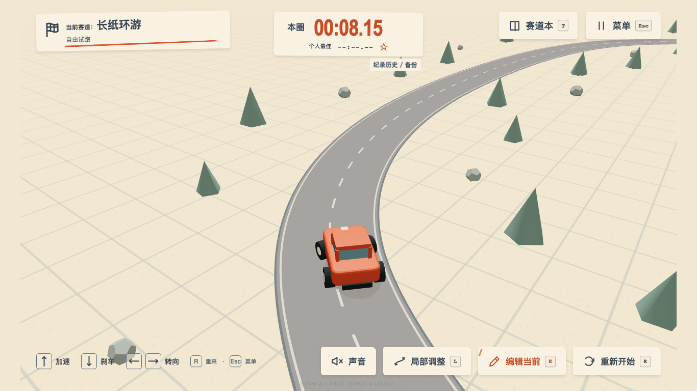
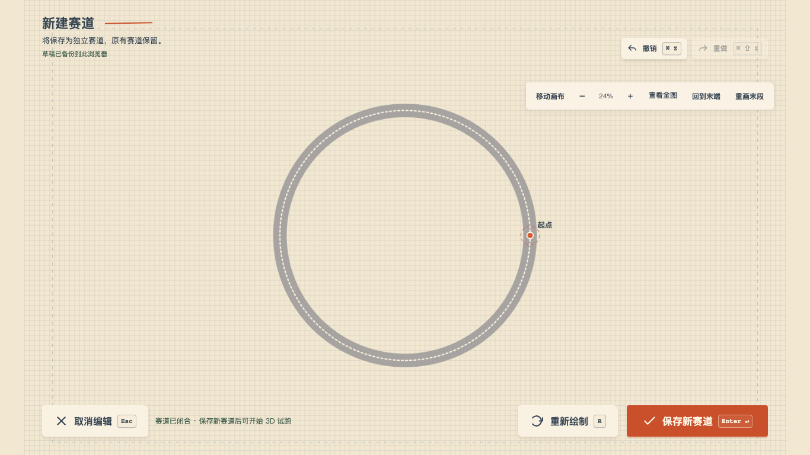

# 纸上飞驰 · Paperlap

方格纸上的玩具赛车：在可拖动、缩放的大纸面上分段画出闭合赛道，再用 **3D 追车视角**亲自驾驶，完成有效圈并挑战本地纪录。道路保持平面，绘图与局部调整使用俯视视图。

新用户打开即可试玩“长纸环游”。已有玩家升级后继续使用原作品，也可在赛道本点击“体验长赛道”，新增一条独立样例。全部游戏逻辑和存档在浏览器本地运行，无后端、无运行时 AI 调用；Phaser、Three.js 和程序美术随包发布。

当前实现范围见[下一版设计](docs/next-version-design.md)，实跑结果、截图与检查边界见[本轮验证记录](docs/next-version-verification.md)。



## 本地运行

需要 Node.js **22.12+**（开发验证使用 22.22.3）、npm，以及支持 **WebGL 2** 的现代桌面浏览器。

```bash
npm ci
npm run dev
```

开发地址默认是 **http://127.0.0.1:5173/**，以终端输出为准。服务不会自动打开浏览器。

```bash
npm run typecheck
npm test
npm run build
npm run preview
```

构建输出在 `dist/`，生产预览默认是 http://127.0.0.1:4173/。引擎 chunk 可能触发 Vite 的体积提示。3D 初始化或 WebGL 上下文失败时会显示恢复提示，已有存档保留。

## 驾驶与赛道本

- 游戏区域获得焦点后，按 **Space** 或点“开始试跑”出发。**↑ / W** 加速，**↓ / S** 刹车，**← / A**、**→ / D** 转向。没有倒车，静止时不原地旋转。
- 镜头从车后上方跟随，朝前观察道路。驾驶使用 3D 视角；绘图和查看全图使用俯视视图。
- **Space** 快速暂停/继续；**Esc** 或顶部“菜单”打开正式菜单。离开窗口、切换标签或游戏区域失焦时自动暂停并清空按键。恢复后，原来按住的油门需松开再按。
- 只有菜单直接从驾驶中打开、仍是原赛道且没有失焦、进入编辑等中断时，Esc 关闭才可恢复驾驶。其他情况需要显式开始或继续。**R** 或“重新开始”回到起点并开始新一圈，保留个人最佳。
- 出界会减速，并使本圈不计成绩。可以开回道路，依次通过检查点并正向跨过起点线后开始新的有效圈。只有有效圈能刷新个人最佳。
- **T** 或“赛道本”打开纸片抽屉，显示真实路线缩略图、当前标记和个人最佳。最多 20 条作品，名称最多 40 个字符，允许重名。
- 在赛道本按 **N** 新建，**↑ / ↓** 选择卡片，**Enter / Space** 使用赛道；Tab 可访问改名和删除。切换后回起点并等待开始；删除需确认，最后一条不能删除。
- “体验长赛道”会把长样例保存为独立作品并切换过去，原作品保留；这个操作也受 20 条容量和写入权限限制。
- 声音初始静音，可在底部或菜单开启。音效启用失败不影响驾驶。

菜单、输入框和快捷键保留原生键盘行为；输入法组合输入和系统组合键不会触发驾驶动作。已有菜单返回规则见[游戏菜单合同](docs/game-menu.md)，历史赛道本交互细节见[赛道本规则](docs/trackbook-interactions.md)；本文说明当前新增行为。

## 分段画长赛道

新建作品，或按 **E / 编辑当前**进入俯视绘图。新建保存为独立条目；编辑当前会重绘并替换这件作品的路线。

1. 按住鼠标左键画第一段，松手保留。
2. 从**蓝色末端**继续画下一段。可以先移动画布，再接着画；找不到末端时点“回到末端”。
3. 用**滚轮**或 **＋ / −** 缩放；按住**鼠标中键或右键**拖动画布，也可先点“移动画布”再拖动。点“继续绘制”退出移动模式，“查看全图”显示整条已画路线。
4. 接回**橘色起点**，出现闭合提示后松手，系统整理接头并校验完整道路。
5. 合法后按 **Enter** 或“保存新赛道 / 保存修改”。保存成功回到等待开始，再点“开始试跑”进入 3D 驾驶。

纸面大小独立于窗口，缩放只改变观察范围，不改变道路和车辆的实际尺度。新路线使用 `5760×3440` 大纸面；样例以约 30–60 秒一圈为体验目标，这不是自绘赛道的圈时上限。



**Ctrl/Cmd+Z** 按绘制段撤销，**Ctrl/Cmd+Shift+Z** 重做；“重画末段”退回上一段末端，**R** 清空重画。平移缩放不进入路线撤销历史。未闭合时通过逐段撤销修改；闭合、校验并保存后可使用局部调整修弯。

未闭合路线是可继续的草稿。交叉、超出纸面、过密道路或过紧弯道会标出问题；可撤销问题段，前面的路线保留。失焦、窗口变化或指针中断会结束当前尚未完成的手势，已完成段保留，不会自动把中断位置接成新路。

有笔迹时按 **Esc** 会先询问是否放弃，默认继续绘制。取消恢复原作品和编辑前状态，不自动驾驶。草稿备份或清理失败会明确提示，不会假装已保存或已清理。

## 局部调整

按 **L / 局部调整**，或从菜单、赛道本进入。它针对当前已保存且可写的作品；进入时车辆、圈时和声音暂停，俯视画面显示原路线、影响范围及受保护的起点区。

在道路上拖动一个弯，松手校验。**Enter / 采用本次调整**加入编辑历史，可继续改另一个弯；**Ctrl/Cmd+Enter / 保存局部修改**才正式保存，并回到等待开始。新几何获得独立成绩身份，作品 UID、名称和历史成绩保留。

局部视图也支持平移、缩放和查看全图。**Ctrl/Cmd+Z** 撤销，**Ctrl/Cmd+Shift+Z** 重做；会话内最多 24 步。**Esc** 先取消拖动或预览，再询问是否放弃已采用修改。非法预览不覆盖最近一次合法调整。

刷新后重新进入局部调整，可恢复匹配同一作品、几何修订、空间版本与算法的草稿，并恢复最近一步撤销/重做。处理状态、失败恢复与返回链沿用[局部编辑合同](docs/local-editor-integration.md)，当前存档键与升级规则以[Save V4](docs/save-v4.md)为准。

## 存档与升级

正式存档为当前 origin 下的 **`paperlap.save.v4`**。每件作品保存路线、名称和 UID；几何修订有独立身份与摘要，个人最佳绑定 **UID＋几何修订＋驾驶规则版本**。规则版本仍为 **2**，仅更换显示与镜头不会清空旧 PB。

- **V3 → V4**：保留原作品尺寸、UID、几何身份、摘要、PB 和历史，不自动放大或替换旧作品。
- **V2 / V1 → V4**：沿用严格迁移和历史归档规则，直接写 V4，不创建中间 V3。无法完整验证的旧数据整体保留，不静默裁剪。
- **V1/V2/V3 原始键保留**，新版不双写或自动删除它们。改名、切换、静音不改变几何身份；实际改线或改变空间版本会生成新修订。

当前草稿各自使用独立键：

| 数据 | 当前键 | 旧数据处理 |
| --- | --- | --- |
| 分段绘图草稿 | `paperlap.draft.v3` | 原 `draft.v1` / `draft.v2` 字节保留并提示，不自动套用到分段绘图 |
| 局部调整草稿 | `paperlap.local-draft.v2` | 首次打开时复制可兼容的旧 `local-draft.v1`，原文保留；清理后保留空 V2 文档，避免再次导入 |

分段草稿记录已完成段和续画位置，刷新恢复后可继续；最多 12 份 / 600,000 字符。局部草稿最多 8 份 / 1,200,000 字符。均不自动淘汰；来源不匹配的草稿不会覆盖正式作品。只读或来源无法验证时停止备份，并在界面说明。

新建、切换、重绘和局部保存遵循**准备候选 → 准备场景 → 可靠写入 → 提交场景**。保存失败保留旧正式状态与草稿，并释放未采用的 3D 候选资源；场景提交异常时要求重新加载。成绩写入失败不更新正式 PB。

V3/V4 共用 **Web Lock 单写入标签**；其他标签只读，无锁能力的浏览器也只读。运行期间和重新打开时核对旧来源与当前存档，外部变更、未知版本、损坏数据或摘要不匹配会停止写入，不自动合并冲突。

HUD 历史入口可查看旧规则、旧几何和归档成绩，并导出全部正式键及草稿原文。回滚旧版只会看到保留的旧键；旧版期间的改动可能使新版进入冲突保护。端口、域名或浏览器不同会使用独立存档。

完整协议见[Save V4](docs/save-v4.md)。[Save V3 RFC](docs/save-v3-rfc.md)、[V2 架构](docs/storage-v2.md)和[原整笔草稿合同](docs/draft-safety.md)保留为历史兼容依据。

## 验证

当前功能的验证入口：

```bash
npm run typecheck
npm test
npm run build
# 先保持开发服务器运行
npm run test:next
# 或验证生产预览
PAPERLAP_URL=http://127.0.0.1:4173 npm run test:next
```

`test:next` 默认连接 http://127.0.0.1:5173/，依次运行 3D 驾驶与分段编辑脚本。输出在 `test-results/next-version/`，包括 JSON 报告与截图。完整圈通过真实页面键盘输入完成；测试读取只读遥测，不修改车辆、圈时或检查点状态来伪造完成。

缺少浏览器时先执行 `npx playwright install chromium`。脚本使用 **`headless: true`** 和独立浏览器上下文，清除 `PWDEBUG`，不接管日常 Chrome、不使用系统鼠标或按键、不自动打开报告。测试结束释放自己的浏览器；核心测试串行执行。开发服务也不会主动打开窗口。实际覆盖、结果与限制见[本轮验证记录](docs/next-version-verification.md)。

仓库保留 `test:browser`、`test:editor`、`test:draft`、`test:storage`、`test:local-game`、`test:motion` 等 P1 阶段脚本，其中部分断言针对旧 V3、整笔闭环和原俯视布局；它们是历史阶段回归工具，不能直接据此宣称本版完整通过。原性能记录和截图也不代表当前 3D 版本性能。

## 代码边界

| 文件 | 职责 |
| --- | --- |
| `src/game/race-view.ts` | 3D 道路、玩具车、追车镜头及候选资源释放 |
| `src/game/scene.ts` | 驾驶状态、固定步长模拟、计圈与显示层协调 |
| `src/game/geometry.ts` | 路线处理、空间版本边界、闭合校验、起点与检查点、长样例 |
| `src/game/vehicle.ts` / `laps.ts` | 车辆运动与有效圈规则 |
| `src/game/editor.ts` / `segmented-draft.ts` | 分段输入、续画、闭合与问题段处理 |
| `src/game/edit-viewport.ts` / `overview-art.ts` | 编辑坐标变换、平移缩放与有界俯视绘制 |
| `src/game/local-editor.ts` / `local-source.ts` | 局部调整、来源与精确几何校验 |
| `src/game/draft-storage-v4.ts` / `local-draft-storage.ts` | 分段草稿与局部草稿持久化 |
| `src/game/save-modern.ts` / `storage-modern.ts` | V3/V4 共用身份校验与存档事务 |
| `src/game/save-v4.ts` / `storage-v4.ts` | 当前 V4 模型、长样例默认存档与会话入口 |
| `src/game/trackbook.ts` / `trackbook-ui.ts` | 作品管理、场景提交、赛道本与长样例入口 |
| `src/main.ts` | HUD、输入焦点、生命周期、声音与各流程接线 |

驾驶手感仍集中在 `src/game/config.ts`。`/?debug=1` 提供只读 `window.paperlapDebug` 快照，正常界面不显示诊断参数。原始美术参考在 `docs/reference/style-reference.png`，首版需求在 `docs/development-brief.txt`。

## 当前边界与历史原型

PC 键盘驾驶优先；不提供手机触控驾驶、坡道、跳跃、立交、道路分叉、实体障碍碰撞或驾驶中 2D/3D 切换。赛道仍为固定宽度的单条闭环；未闭合时只能按段撤销重画，保存后可局部改弯。正式路线最多 900 点，过紧弯或过近道路会被拒绝。没有账号、云同步、公开排行榜、幽灵车或车辆养成。镜头和路线变化是否更好玩，需要实际试玩判断。

旧局部弯道原型保留为独立演示：`npm run demo:local-edit`，手动访问 http://127.0.0.1:5174/prototypes/local-edit.html。它读取旧 V2/V3，不作为当前 V4 大地图流程；刷新丢失演示调整，默认生产构建不包含原型。历史依据见[局部编辑 RFC](docs/local-edit-rfc.md)及[原型验证](docs/local-edit-verification.md)。
