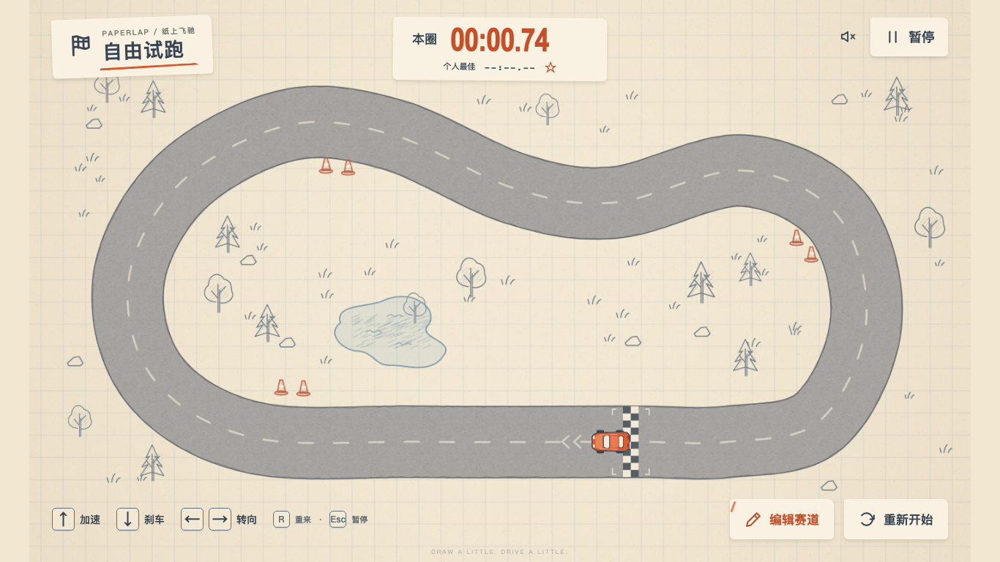
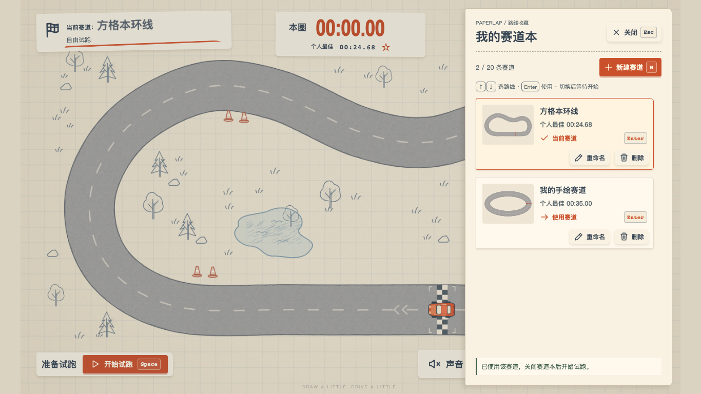

# 纸上飞驰 · Paperlap

方格本上的 2D 玩具赛车。画一条首尾相连的路线，用键盘自己驾驶，完成一圈并挑战本地纪录。默认赛道打开即可玩，全部游戏逻辑在本地运行，无后端、无 AI 调用、无外部字体或资源请求。



## 本地运行

需要 Node.js **22.12+**（开发验证使用 22.22.3）、npm 和现代桌面浏览器。

```bash
npm ci
npm run dev
```

打开终端显示的地址，默认是 **http://127.0.0.1:5173/**。服务不会自动启动浏览器。

```bash
npm run typecheck
npm test
npm run build
npm run preview
```

构建输出在 `dist/`；生产预览默认地址为 http://127.0.0.1:4173/。Phaser 引擎随包一起发布，首屏无需远程下载素材。Vite 可能提示引擎 chunk 超过 500 kB，这不影响构建或运行。

## 怎么玩

- 游戏区域获得焦点时按 **Space** 或点击“开始试跑”，按住 **↑ / W** 加速，**↓ / S** 刹车，**← / A**、**→ / D** 转向。没有倒车，静止时不原地旋转。
- **Space** 在开始、暂停和继续之间切换；驾驶时 **Esc** 或“暂停”冻结车辆与计时。离开窗口、切换标签或游戏区域失去焦点时自动暂停，松开所有按键。
- 游戏区域按 **R** 或“重新开始”回到起点并开始新一圈，保留最快成绩；ready、running、paused 均可用。
- 左上纸片以“当前赛道：名称”为主标题，长名称截断显示，鼠标悬停可查看全文，键盘也能聚焦名称。“自由试跑”为次要模式信息；右上书本图标 +“赛道本”+ **T** 打开右侧纸片抽屉，显示真实路线缩略图、个人最佳与当前标记。名称最多 40 个字符，允许重名。
- 游戏区域按 **E** 或点击“编辑当前”进入画线模式，顶部持续显示“编辑当前赛道”、目标名称和替换说明。在虚线范围内按住鼠标左键画一个大圈，回到起点圆圈内松开即可自动闭合、整理手抖和接头。圆圈变绿、显示“已回到起点”时就可以松开，不必精确接上第一笔。
- 抽屉按 **N** 新建，按 **↑ / ↓** 在卡片主按钮间移动焦点，按 **Enter / Space** 使用赛道；Tab 可访问改名、删除。改名/删除确认中 **Esc** 先回列表，列表中 **Esc** 关闭并回到入口，关闭不会自动恢复驾驶。
- 新建时显示“新建赛道”，通过“保存新赛道”或 Enter 保存为独立条目，原有赛道保留，再点击“开始试跑”出发。编辑当前时通过“保存修改并试跑”或 Enter 替换当前条目的路线并起跑。切换赛道会回到起点、清空本圈并等待开始，删除需要明确确认，最后一条不能删除。
- 两种绘图模式均可按 **R** 清空重画，按 **Esc** 取消并恢复原赛道、车辆位置和计时。绘图提示位于画布顶部和底部；准备/暂停操作位于底部纸条，成功与新纪录反馈位于右上边缘。实际快捷键均以“图标 + 中文动作 + 键帽”显示；输入框、IME、Ctrl/Meta/Alt 和按钮原有的 Enter/Space 操作保留，动作键忽略长按重复。
- 开放线、交叉、过短、确实容不下道路的尖弯、道路挤在一起或太靠纸边仍会提示原因。无效草稿不能起跑或覆盖存档。拖画时失焦、改变窗口大小或丢失鼠标捕获会中断当前笔迹，可以直接重新按住鼠标画一圈。
- 出界会明显减速，并使本圈不计成绩。仍能开回道路，按顺序经过整圈检查点、正向跨起点线后开启新的有效圈。想立刻重试可以按 **R**。
- 上方显示本圈与个人最佳。只有有效圈刷新纪录。底部“声音”按钮可开启声音或静音，初始为静音；音效启用失败不影响游戏。



抽屉约 220ms 打开、200ms 关闭；卡片悬停、按钮按压和边缘纸贴提供轻量反馈。选择成功才更新标记与反馈，失败保留旧画面。系统设置“减少动态效果”时取消动效。完整状态表、焦点与失败恢复见 [交互规则](docs/trackbook-interactions.md)。

## 存档

使用当前网站 origin 的 `localStorage`，键名为 **`paperlap.save.v2`**，保存赛道条目、活动赛道、成绩、旧孤立成绩归档和声音偏好。端口、域名或浏览器不同，会有独立存档。

每个条目有稳定 UID；赛道仍保存几何指纹 ID、名称、固定道路宽度和最终中心线，派生数据加载时重建。成绩同时绑定条目 UID、几何指纹和规则版本：改名保留成绩，改画路线不会套用旧成绩，同几何的不同条目也不共享个人最佳。赛道本最多保存 20 条，刷新后恢复全部条目、活动赛道及各自成绩。

新建、切换、改名、删除先保存成功再更新正式条目；失败会显示原因并保留旧数据，新建时也会保留有效草稿供重试或取消。预览和取消不写盘。原有编辑、声音和成绩在存储受限时仍可继续本次试玩，会提示未保存；刷新后可能丢失这些未保存变化。场景提交异常时停止操作并提供重新加载入口。状态转换与恢复边界见 [赛道管理流程](docs/trackbook-flow.md)。

首次加载有效 V1 时自动迁移；**原 `paperlap.save.v1` 键值始终保留且不再修改**。旧当前赛道的所有可归属规则成绩转入 V2，其他历史成绩放入 `legacyRecords` 归档，不虚构已丢失的路线。只有成功写入的 V2 才在下次加载时优先使用。损坏 V2 会临时回退有效 V1 或默认赛道，并保留损坏原文、拒绝覆盖；禁用存储、超配额或达到容量上限时明确提示失败，仍可继续试跑，不自动裁剪有效数据。结构、上限与恢复限制见 [Save V2 架构文档](docs/storage-v2.md)。

第二轮转向调校使用规则版本 2：中高速转弯能力增强，方向起效和回正更快。已保存的赛道、声音偏好及版本 1 成绩继续保留，当前 HUD 从版本 2 的新纪录开始统计，两个版本的圈速不会混用。

## 无头浏览器验证

保持开发服务器运行，在另一个终端执行：

```bash
npm run test:browser
npm run test:sound
npm run test:handling
npm run test:editor
npm run test:storage
npm run test:trackbook
```

首次运行若缺少测试浏览器，先执行 `npx playwright install chromium`。脚本使用 `headless: true` 启动 Playwright 自带的独立 Chromium，不使用日常 Chrome。不连接已有浏览器、不使用系统级输入、不打开测试报告。所有键盘和鼠标操作都只发送给无头测试页面，并忽略继承的 `PWDEBUG` 环境设置。

也可通过 `PAPERLAP_URL=http://127.0.0.1:4173 npm run test:browser` 验证生产预览。测试会修改自己的隔离浏览器上下文中的存档，不接触日常浏览器数据。自动化截图写入 `test-results/screenshots/`，结果写入 `test-results/browser-report.json`；`docs/screenshots/` 保留交付时选取的截图。

`test:sound` 用真实页面鼠标和键盘验证驾驶中开关声音时计时、车辆、音频增益、持久化与输入保持正常，检查 ready/paused 下 Tab、Enter、Space 的原生行为，并投递窗口/标签生命周期事件验证安全暂停。报告保存在 `test-results/sound/report.json`；不切换系统前台应用。

`test:handling` 检查真实方向输入、连续两圈较快驾驶、急弯前松油以及旧成绩迁移，结果为 `test-results/handling-report.json`，截图为 `test-results/handling-v2.png`。

驾驶输入的等待按只读遥测中的模拟时间判断，避免不同无头渲染速度造成误报；完整圈脚本保留有界的墙钟超时。R 重置通过真实键盘事件后立即采样，验证计时归零，不向游戏写入车辆或计时状态。

`test:editor` 用真实指针绘制接近报错截图的路线和带手抖的路线，检查闭合提示、R/Enter/Esc、输入焦点、拖画中断恢复和三种桌面尺寸。报告与截图保存在 `test-results/editor/`。

`test:storage` 检查真实 localStorage 的 V1→V2 迁移、规则 1/2 成绩、孤立成绩归档、V1 原文保留、改线及同几何多 UID 的成绩隔离，以及损坏数据、配额错误和受限存储下继续驾驶。报告与截图保存在 `test-results/storage/`。

`test:trackbook` 从真实鼠标新建 B 开始，检查 A/B 切换与刷新恢复、车辆/圈速/HUD/输入/声音同步、改名、编辑取消、删除确认、容量上限、配额与存储拒绝下的失败重试，以及三种桌面尺寸与键盘焦点。还检查长/短赛道名、新建/编辑意图、暂停和通知的道路/车辆遮挡，并通过真实键盘有效圈触发新纪录截图。P1-03 扩展检查 T/E/N/Space/R、分层 Esc、输入/IME/组合键、原生按钮激活、真实 SVG 与成绩、20 条内部滚动、失败不闪成功、动画中断与 reduced motion。报告与截图保存在 `test-results/trackbook/`，`drawer-*.png`、`switch-ready-*.png` 为 P1-03 抽屉与切换验收画面，`ux-*.png` 保留名称、绘图和通知回归。

`npm test` 同时覆盖缓存突变安全和 20 条赛道、每条 350/900 点的性能回归。`npm run bench:storage` 可输出操作耗时；与原 PR 版本比较、测量真实 localStorage 的命令及结果见 [存档性能复核](docs/storage-performance.md)。未变化几何通过完整坐标快照安全复用，外部存档和变更路线仍严格验证。

已覆盖实际按键驾驶、暂停/恢复/R、失焦处理、鼠标画线后驾驶、错误与取消恢复、刷新存档、完整有效圈与纪录、出界、反复编辑，以及 **1366×768、1280×800、900×700** 的布局和坐标映射。完整圈测试由外部测试脚本读取只读遥测、发送真实键盘事件完成，没有修改车辆、计时或检查点状态。

## 代码边界

| 文件                       | 职责                                                 |
| -------------------------- | ---------------------------------------------------- |
| `src/game/geometry.ts`     | 清理/闭合/平滑/等距采样、最终几何校验、起点与检查点  |
| `src/game/vehicle.ts`      | 独立车辆运动、120 Hz 固定步长、过大帧间隔上限        |
| `src/game/laps.ts`         | 有方向的移动线段过线、检查点顺序、有效圈与计时       |
| `src/game/save.ts`         | 纯 Save V2 模型、验证、V1 迁移、条目操作与成绩归属   |
| `src/game/storage.ts`      | localStorage 加载、受保护写入与失败报告              |
| `src/game/trackbook.ts`    | 新建/编辑意图、管理命令、候选保存与场景提交协调      |
| `src/game/trackbook-ui.ts` | 纸片抽屉、路线卡片、改名/删除、分层焦点与可取消动效  |
| `src/game/shortcuts.ts`    | 游戏/绘图/抽屉的按键上下文和保护规则                 |
| `src/game/thumbnail.ts`    | 从真实中心线及道路宽度生成 SVG 缩略图                |
| `src/game/ui.ts`           | 共用操作图标与中文按钮/键帽内容                      |
| `src/game/art.ts`          | 本地程序绘制纸张、铅笔道路、装饰、小车；静态贴图缓存 |
| `src/game/scene.ts`        | Phaser 场景适配、有限数量的轮胎痕迹和灰尘            |
| `src/game/editor.ts`       | 指针/世界坐标映射、草稿、预览、采用与撤销            |
| `src/main.ts`              | HUD、生命周期、键盘焦点、声音偏好与状态切换          |

手感集中在 `src/game/config.ts`。美术参考保存在 `docs/reference/style-reference.png`，开发需求保存在 `docs/development-brief.txt`。参考整图只用于开发文档，运行时画面是独立绘制的真实游戏。

本地诊断可使用 `/?debug=1`，控制台中的 `window.paperlapDebug` 仅提供快照，不提供修改游戏的接口，正常界面不显示调试参数。

## 首版限制

PC 键盘优先，未提供手机触控驾驶；赛道本提供本地最多 20 条路线的纸片抽屉、缩略图和键盘导航。不支持控制点修改或交叉道路。V1 孤立成绩缺少路线数据，暂只能归档；存档没有跨标签页合并协议，建议只在一个标签页游戏。几何校验对小半径和紧邻路段较保守，失败时把圈画大、把弯画圆即可。赛车采用简化惯性模型；没有倒车、实体障碍碰撞和幽灵车。声音是轻量合成音，自动化检查开关、保存和切换后引擎静音，听感需人工判断。
