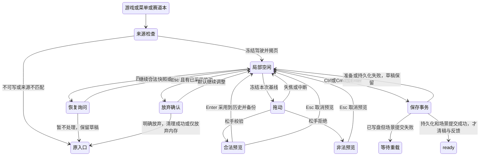

# P1-05B-02B：正式局部调整状态与恢复合同

基线 master `347d2eb3`，Issue #16。此合同先于实现提交。复用 LocalEditModel、有限弧长变形、Save V3 和 Trackbook 同步事务；不改几何公式、物理、圈速或 RULES_VERSION。

## 界面与状态

游戏底部、Esc 菜单、赛道本均有“局部调整 L”，仅针对已可靠保存的活动 V3。E 仍为原整圈重画；N 仍为新建。只读/损坏/旧客户端来源冲突/首次升级失败时禁止进入，持续展示存档原因。进入前再次检查写入锁、原文基线和 UID/身份/摘要。

局部编辑保持原路线虚线、已采用路线、当前预览、黄色影响范围和起点保护区。标题“局部调整 · 名称”，说明与状态放在顶部/底边，不覆盖道路中心。正式 scene.trackData、车辆与圈时在编辑期间不变，独立 Canvas 绘候选；pointermove 经 RAF 合并，松手严格验证一次，无逐帧 Phaser 纹理或全量几何校验。

快捷键：L 在 ready/running/paused、菜单首页和赛道本列表可用；输入框/IME/组合键不触发。编辑器 Enter 只采用，Ctrl/Cmd+Enter 正式保存，Ctrl/Cmd+Z、Ctrl/Cmd+Shift+Z 撤销/重做（会话最多 24 层）。按钮 Enter/Space 保留原生操作。编辑中 T/E/N/L/R/Space 不触发游戏操作；重复 Enter/Esc/保存/历史键不得多次执行。Esc 顺序为取消当前拖动/预览→确认放弃已采用修改→原入口。退出不自动起跑。

GameMenu/MenuState 继续拥有 game/menu/book-game/book-menu 返回路径；局部编辑不扩展整笔 EditIntent。Trackbook 增加显式 beginLocal/commitLocal/cancelLocal，source 令牌严格绑定活动 UID、geometryIdentity、geometryDigest、算法版本。候选点数和起点两侧相邻线段保持，正式提交复用 prepare→V3 write/readback→scene apply。未变化候选无写入、无新身份、无成功奖励。

## 独立局部草稿

`paperlap.local-draft.v1`：schemaVersion=1，最多 8 份/1,200,000 字符，不自动淘汰。每份 source 包含 uid、geometryIdentity、geometryDigest、algorithmVersion=1；checkpoint 保存精确 current 中心线、最近 previous 和 next（各可为空），updatedAt。不是整笔 raw，也不是鼠标 delta 或图片。会话内 24 层，刷新仅恢复最近一步撤销/重做，界面明确说明。

只在采用、撤销、重做与生命周期 checkpoint 备份；拖动/非法/尚未采用预览不写盘。无改变的 checkpoint 避免重复写。cold 读取/恢复严格验证保存的合法中心线；写入前比较局部草稿原文、正式 V3 原文和 session.check，写后读回，其他条目字段和值保留。旧 V1/V2 与整笔 draft.v1/v2 不写入或删除。全部原文导出新增 local-draft.v1。

恢复只在主动进入局部调整后显示“继续局部调整 / 放弃草稿 / 暂不处理”，默认继续。继续仅恢复编辑候选；暂不处理或 Esc 不清草稿，回原入口。UID/身份/摘要/算法不匹配不套用；损坏/未知原文保留并提示本次未备份。

## 失败矩阵

| 状态                                         | 行为与恢复                                                                     |
| -------------------------------------------- | ------------------------------------------------------------------------------ |
| 只读锁、升级未成功、来源冲突、reloadRequired | 禁止进入或提交，持续说明；不保存到内存冒充成功                                 |
| 指针取消、resize、窗口/标签失焦              | 释放捕获、取消未采用预览；最近合法已采用路线与备份保留，驾驶不继续             |
| 非法预览                                     | 红色路线、错误位置和中文原因；禁止采用/保存该预览，已采用路线不变              |
| 草稿初读失败/未知原文                        | 可继续内存调整，明确“未备份，请勿刷新”；显式确认后仅放弃本次内存，不删未知备份 |
| 已确认草稿清理失败                           | 确认放弃仍留编辑器；不绕过失败清理                                             |
| 草稿 quota/外部草稿变化                      | 保留旧备份和当前内存；状态持续可见，不反复覆盖外部分支                         |
| 正式准备或保存失败                           | 正式 UID/几何/身份/PB 不变，保留已采用候选/草稿，不庆祝                        |
| V3 写盘成功但 scene apply 失败               | 停止进一步操作，保留草稿，可靠重载新 V3；旧身份草稿不得覆盖新修订              |
| 可靠保存与场景提交都成功                     | 原 UID/名称/历史保留，新几何由 V3 分配新身份；清对应草稿、回 ready，不自动驾驶 |
| 保存成功后清稿失败                           | 正式保存已完成，说明旧草稿保留；下次来源不匹配，不自动套用                     |

## 验证计划

纯数据覆盖 source/结构/容量/几何、历史与草稿归属、重试、读回失败、已知清理与未知初读、正式事务故障顺序。真实隔离 headless Chromium 覆盖两次连续采用、非法、撤销重做、保存刷新与 A/B/PB、恢复与中断、所有返回路径和快捷键保护、quota/锁/外部变更/prepare/apply 异常及旧键字节不变。三视口包括长名、HUD/菜单/抽屉/局部编辑布局，保留 reduced-motion 与键盘焦点。

性能测正式游戏的 200/450/900 点真实 pointermove、松手、采用与保存，包括 CPU 4× 降速，记录验证次数、帧延迟与资源；不以独立原型替代。交付三尺寸截图、真实进入→两弯→保存→刷新及非法/撤销录屏。运行全部指定既有回归；README/RFC/验证文档记录实测和边界。独立 PR，停在 Code Review，不自动合并。
