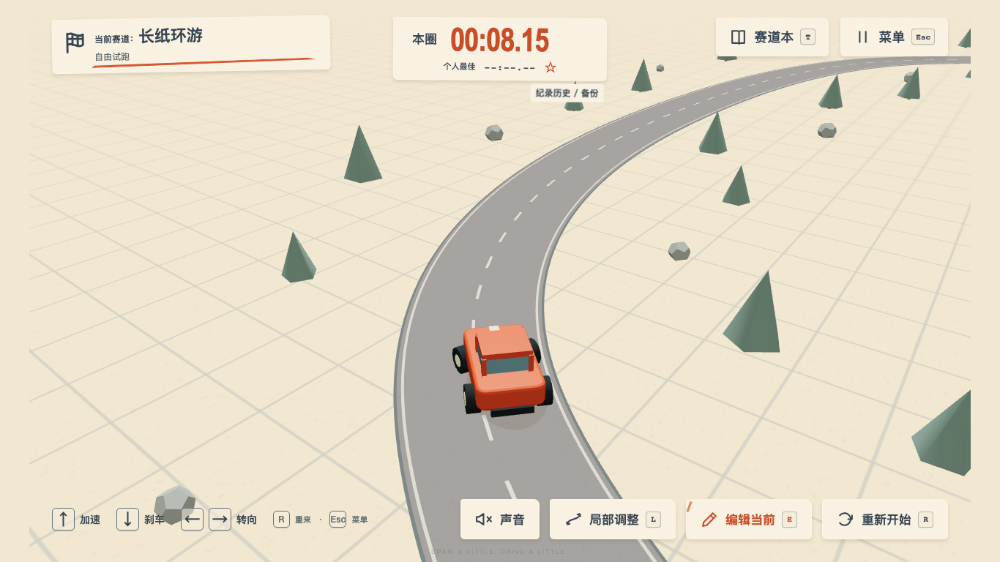
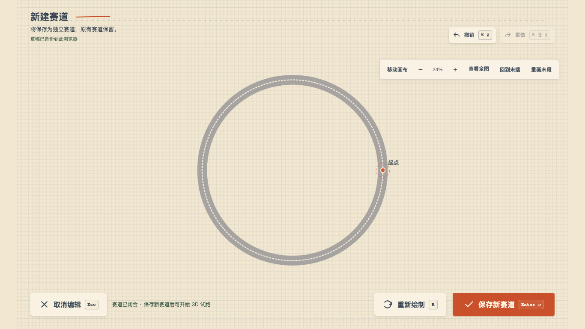

# 3D 驾驶与大地图分段绘制：验证记录

日期：2026-11-17。实现与自动化检查已完成；用户随后自行试玩，反馈“还行”，并决定先提交发布。具体看弯、镜头舒适度和趣味性尚未逐项收集反馈。

## 结果

| 检查 | 实际结果 |
| --- | --- |
| 核心测试 `npm test` | 143 / 143 通过，串行执行 |
| 类型与生产构建 `npm run build` | 通过；包含 `tsc --noEmit` |
| 生产版 3D 驾驶脚本 | 5 组检查通过，普通运行无页面异常 |
| 生产版分段编辑脚本 | 9 组检查通过，无页面、控制台或资源请求错误 |
| 样例有效圈 | 53.562 秒，真实键盘驾驶，PB 保存并刷新保留 |
| 自绘赛道有效圈 | 26.934 秒，12 段真实鼠标绘制、跨屏闭合保存后驾驶 |
| 版本兼容 | V3 作品、几何身份和 PB 保留，旧正式键与草稿原文字节不变 |
| 重复编辑资源 | 三轮普通编辑与局部编辑进入/取消后均回到 28 个 geometry、3 个 texture、0 个待提交候选 |

自绘路线约为直径 2000 的圆形，用于验证跨屏操作链路，最终保存 786 个点、道路宽度 108。它的 26.934 秒圈时没有触发长度限制；30–60 秒只标定默认样例。

## 驾驶检查

对构建后的版本依次检查 1366×768、1280×800、900×700 三种尺寸。真实键盘加速后暂停，车辆、计时和镜头快照保持不变；按 R 重置，再完成长样例有效圈。PB 写入 V4，刷新后几何身份与成绩一致。

测试驾驶员读取只读路线和车辆遥测，选择转向、油门及刹车按键；没有写入车辆位置、时间、检查点或成绩来跳过驾驶。该方法证明输入、模拟和存档贯通，不代替玩家凭画面判断弯道的试玩。

另外通过 WebGL 的上下文丢失扩展模拟图形故障，验证 ready 状态也能进入明确恢复界面，并停止驾驶。故障注入前没有页面异常；故障后的恢复日志属于预期行为。



## 绘制、恢复与改弯

旧 V3 用户从赛道本点击“体验长赛道”，新增独立样例，原作品及 PB 保留；重复点击不会重复新增。

空白存档中通过真实指针画 12 段路线，使用右键平移与滚轮缩放。第二段后加入交叉段，检查可见错误并按段撤销；刷新后恢复两段草稿，撤销/重做仍按段工作，再接着画完路线。最终路线超出初始视口，闭合后保存为独立 V4 作品，保持 ready，刷新后仍可驾驶。

自绘赛道跑出有效圈后，进入俯视局部视图，缩放定位、真实拖弯、采用并保存。新几何身份的 PB 为空，旧几何的 PB 数值和归属完整保留。再次调整并放弃，正式存档不变，车辆不会自动起跑。

三轮普通编辑取消和局部编辑取消后采样 3D 资源，全部回到同一基线。资源计数能发现这条流程中的 GPU 对象增长，不等同于完整的长期堆内存泄漏审计。



## 运行成本与测试环境

本轮在 Apple M3 Pro、macOS arm64、Node 22.22.3、Playwright Chromium 141.0.7390.37 上运行。浏览器为独立无头实例，音频静音；最终两个脚本串行、以 `nice -n 10` 运行，未打开或操作日常浏览器，也没有系统鼠标或按键输入。测试及自建预览服务均已关闭。

长样例驾驶期间记录 2131 个浏览器 rAF 间隔，中位数 **16.8 ms**，P95 **33.4 ms**。这表示本次无头运行中的回调节奏，不是每帧 GPU 耗时，也不保证所有机器稳定 60 FPS。驾驶结束时 renderer 为 34 次 draw call、14702 个三角形、28 个 geometry、3 个 texture，像素比 1。

实现将设备像素比限制为 1.25，静止画面跳过重复 GPU 绘制，装饰实例化，道路使用网格，纸纹使用 256×256 重复纹理。编辑画布固定 1440×860，不随世界面积增大。Phaser 与 Three.js 一起发布，生产 JS 为 **1934.73 kB / gzip 516.74 kB**；构建保留 chunk 超过 500 kB 的体积提示。

## 复现与证据

```bash
npm test
npm run build
npm run preview -- --port 4183 --strictPort
# 另一个终端，顺序运行两个无头脚本
PAPERLAP_URL=http://127.0.0.1:4183 npm run test:next
```

测试输出在 `test-results/next-version/`：`core-tests.log`、`build.log`、`drive-report.json`、`editor-browser-report.json` 及三尺寸截图。仓库保留上面两张交付截图；原始测试目录可由脚本重新生成。旧 P1 浏览器脚本存在针对 V3、整笔编辑和旧布局的断言，本轮没有把它们列为新版通过项。

未进行有头试玩或用户桌面操作。还需玩家实际判断连续弯是否看得清、转向是否可预测、镜头是否舒适，以及是否愿意再跑一圈；这些体验项不能由自动化宣布完成。
